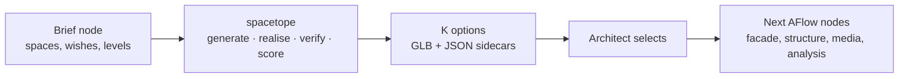
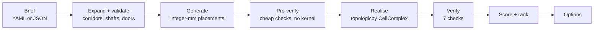

# spacetope

**From a schedule of accommodation to verified 3D space assemblies.**

spacetope takes an architect's list of spaces (name, size, height, tolerance, use) and returns several
candidate buildings. Each candidate is a non-manifold cell complex, with corridors, stairs, lifts and doors,
and each one has been checked and scored before you see it. The architect compares the options and carries
one forward.

spacetope is the space-generation engine of [AFlow](https://aflow.adventurous.systems). It also runs on its
own, from the command line, from Python, or in its own browser canvas.

---

## Why spacetope

Early-stage design starts with a brief: so many offices of about this size, a meeting room next to the
kitchen, two stairs, a lift serving every floor. Turning that brief into a first spatial arrangement is
still mostly manual work. The generative tools that automate it tend to give you pictures, or 2D plans in
which rooms overlap, corridors are missing and nothing records which room opens onto which.

spacetope works on the topology of the building, not on a drawing of it:

- **Every space is a cell, and every shared wall is one shared face.** The output is a
  [topologicpy](https://github.com/wassimj/topologicpy) `CellComplex`, so adjacency, access and the routes
  out of the building are part of the model and can be queried. They are not inferred from a drawing.
- **Circulation is built in.** Corridors give horizontal movement. Stairs and lifts are stacked through
  every level they serve. Doors are real apertures in the shared faces.
- **Options, not answers.** Each generator returns several distinct candidates with scores, and every
  generator takes a seed, so any result can be reproduced.
- **Nothing unverified reaches the architect.** Every option is rebuilt in the geometry kernel and has to
  pass seven checks first (see [What you get](#what-you-get)).
- **Exact geometry.** The solvers work on an integer millimetre grid, so walls meet exactly and never
  "almost". Geometry is never nudged to make it merge.

## spacetope in AFlow

[AFlow](https://aflow.adventurous.systems) is a node-based design environment: a canvas of connected nodes
that orchestrates generative media and design agents. spacetope is the step that turns a brief into massing:



Each option travels as **one GLB file with a node per space (`cell_0`, `cell_1`, …)**, plus JSON sidecars
for the wall-node graph, the per-cell data and the scores. Downstream nodes can then address every room by
name and know its neighbours, without ever handling topologic's internal formats.

## How it works



1. **Brief.** Spaces with nominal width, length and height, a tolerance band (±10 % by default) and a use.
   Wishes are optional: which rooms must touch, which need a door between them, which want an outside wall,
   which level a room is on. So are an envelope and a number of levels.
2. **Expand and validate.** A compact circulation section becomes concrete spaces: one corridor per level,
   and stairs and lifts that run through every level they serve. Problems come back as plain sentences
   ("level 2 is not served by any stair") before anything is generated.
3. **Generate.** One of four generators places every space as a box on an integer millimetre grid (see
   [Generators](#generators)).
4. **Pre-verify.** Overlaps, required contacts and access are checked on the boxes in microseconds. Only
   survivors go on to the kernel.
5. **Realise.** Each space becomes a `Cell`, the cells merge into one `CellComplex`, and doors are cut as
   apertures. Data such as name, use and level are carried on every cell.
6. **Verify and score.** The realised complex is the final truth. An option is kept only if it passes every
   check.

### Vocabulary

| Term | Meaning |
|---|---|
| **Brief** | The architect's input: spaces, wishes, and optionally an envelope and a number of levels. |
| **Space** | One box to be realised as a cell. Uses: `room`, `corridor`, `stair`, `elevator`, `void`. |
| **Wall node** | One of a space's six faces (`+x −x +y −y floor ceiling`), with its extent and normal. |
| **Contact** | Two wall nodes of different spaces that will become one shared face. `ceiling ↔ floor` contacts stack spaces into levels. |
| **Assembly graph** | All spaces' wall nodes plus the intended contacts. It records intent, not geometry. |
| **Realisation** | Solving exact coordinates for an assembly graph and building the cell complex. |
| **Option** | One realised, verified and scored cell complex, offered to the architect. |
| **Corridor chain** | A corridor made of several segments meeting end on (an L, U or Z), for briefs that need more frontage than one straight corridor has. |

## What you get

**Seven checks**, all of which must pass:

| Check | Meaning |
|---|---|
| `built` | The kernel produced a cell complex. |
| `cell_count` | One cell per space, no more and no fewer. |
| `no_slivers` | Every cell has the volume of its space, so no overlap created a stray cell. |
| `contacts` | Every intended contact exists as a real shared face. |
| `dictionaries` | Every cell carries its data (name, use, level, …). |
| `constraints` | Inside the envelope, on the stated number of levels, and every stair and lift spanning the levels it serves. |
| `doors` | Every door is where access needs it and connects the two spaces it should. |

**Scores**, used to rank options and shown on each option card:

| Score | Meaning |
|---|---|
| `adjacency` | Share of the brief's contacts realised as shared faces (1 = all). |
| `deviation` | Mean deviation of sizes from nominal, as a fraction (0 = exact; lower is better). |
| `compactness` | Form factor: surface of a cube of the same volume ÷ external surface (1 = cube-like). |
| `circulation` | Corridor, stair and lift floor area ÷ room floor area (lower is leaner). |
| `stacking` | Share of wall lines on each level that continue the level below (0 for one level). |
| `vertical` | Share of spaces reachable from one another through doors (1 = everything reachable). |
| `envelope_fit` | Built volume ÷ envelope volume, when the brief gives an envelope. |
| `daylight` | Share of rooms with at least one outside wall. |

**Export formats:** GLB (one node per cell), BREP with a selector sidecar (to restore the per-cell data),
OBJ + JSON, Plotly HTML, and topologicpy's TPY archive, which keeps the cell data and the doors in one file.

## Generators

| Generator | Good for | Not for |
|---|---|---|
| `beam` | Any brief first; multi-level buildings with stairs and lifts; fast. Builds the building attachment by attachment, a wall against a wall, keeping the best partial layouts. | Guaranteeing a wish (wishes are scored, not enforced). |
| `cpsat` | Rich room-to-room wishes, chained corridors, and proving a brief is impossible. An exact constraint model on OR-Tools CP-SAT. | Short time budgets on very large single levels. Not seed-deterministic. |
| `dual` | Listing genuinely different plan topologies for a rich adjacency wish list (rectangular duals). | Multi-level briefs; briefs whose rooms cannot tile within tolerance. It reports the tolerance that would work. |
| `treemap` | A sub-second baseline and a starting point for the others. | Wishes, tolerance bands, more than one level. |

## Getting started

### Requirements

- **macOS on Apple Silicon.** This is the tested platform. The geometry kernel `topologic_core` ships no
  macOS Intel wheel.
- **Python 3.11 exactly** (`>=3.11,<3.12`); 3.11.9 is tested.
- **Node.js 18 or newer**, only for the browser canvas and its tests.
- About 1 GB of disk for the Python environment.

### Install

```bash
git clone https://github.com/Adventurous-Systems/spacetope.git
cd spacetope

# Python 3.11 (with pyenv: pyenv install 3.11.9 && pyenv local 3.11.9)
python3.11 -m venv .venv
source .venv/bin/activate

pip install -e ".[dev]"      # engine + web server + test tools
# pip install -e .           # engine only (CLI and Python API)
# pip install -e ".[web]"    # engine + web server, no test tools
```

Check the install. This runs the fast test suite, about 60 tests in under 10 seconds:

```bash
pytest -m "not slow"
```

### Your first options

```bash
spacetope generate fixtures/eight_rooms_corridor.yaml --generator beam --seed 0 --out out/eight --html --save
```

`out/eight/` now holds `options.json` with the checks and scores of every option, one Plotly HTML file per
option (open it in a browser: cells coloured by use, shared-face nodes in red, the realised graph in black),
and with `--save` the BREP, selector and graph files of each option.

Try a two-storey building with a stair and the exact engine:

```bash
spacetope generate fixtures/two_levels_stair.yaml --generator cpsat --out out/two --html
```

### The browser canvas

Run two terminals from the repository root:

```bash
# 1. the API on port 8000
uvicorn backend.app.main:app --port 8000 --reload --reload-dir spacetope --reload-dir backend

# 2. the canvas on port 5173 (forwards /api and /static to port 8000)
cd frontend && npm install && npx vite --port 5173
```

Then open <http://localhost:5173>:

1. Pick a brief from the list on the left, or edit its spaces and contacts.
2. Choose a generator and press **Generate**.
3. Click an option card. The 3D complex appears behind the wall-node graph. Use the slider to change its
   transparency.
4. Click a red wall node to highlight the two cells that share that face. Hold **Space** to orbit the 3D view.
5. **Select and export** writes the chosen option (BREP, selectors, placement, graph JSON) to
   `out/api/selected/`.

Small briefs return options in seconds. The 64-space three-level school takes about a minute.

### Command reference

| Command | What it does |
|---|---|
| `spacetope generate BRIEF --generator G --seed N --out DIR [--html] [--save]` | Generate, verify, score and rank options. `--params '{"k": 4}'` sets how many. |
| `spacetope realise BRIEF PLACEMENT [--html F] [--save F]` | Build and verify a hand-made placement (integer-mm boxes). |
| `spacetope floors BRIEF [--generator beam\|cpsat]` | Find how many floors a brief needs within its envelope. |
| `spacetope export --stem STEM --obj F.obj --json F.json` | Write OBJ and JSON of an option saved with `--save`. |
| `spacetope programme NAME --seeds 0-99 --out DIR` | Draw briefs from a building programme (see below). `--dataset rows.jsonl` writes training rows instead. |
| `python bench.py --out bench/scoreboard.csv` | Scoreboard over every generator, brief and seed. |

## Writing a brief

```yaml
name: eight_rooms_corridor
levels: 1                          # optional; 2+ assembles levels around stair and lift cores
envelope: {w: 20, l: 14, h: 6}     # optional site box, in metres from the origin
spaces:
  - {name: corridor, w: 1.8, l: 12, h: 3, program: corridor}   # width fixed, length free
  - {name: office_a, w: 4, l: 3, h: 3, program: room, wishes: {exterior: true}}   # ±10 % per side
  - {name: kitchen,  w: 3, l: 3, h: 3, program: room}
  - {name: meeting,  w: 5, l: 4, h: 3, program: room}
contacts:                          # faces that must be shared
  - [corridor, office_a]
  - [corridor, kitchen]
  - [corridor, meeting]
  - [kitchen, meeting, {door: true}]   # and a door between them
```

For multi-level buildings, declare the circulation once and let spacetope expand it:

```yaml
name: three_levels_core
levels: 3
level_height: 3
envelope: {w: 22, l: 16, h: 9}
circulation:
  corridor: {w: 1.8, l: 10}                 # one corridor per level: corridor_0, corridor_1, corridor_2
  stairs: [{name: stair, w: 3, l: 5}]       # serves every level
  lifts:  [{name: lift, w: 2.5, l: 2.5, serves: [0, 2]}]
  doors:  {room: {w: 0.9, h: 2.1}, stair: {w: 1.0, h: 2.1}, lift: {w: 1.1, h: 2.1}, jamb: 0.1}
spaces:
  - {name: office_c, w: 4, l: 3, h: 3, program: room, wishes: {level: 1}}
  - {name: meeting,  w: 5, l: 4, h: 3, program: room, wishes: {level: 1}}
contacts:
  - [corridor_1, office_c]
  - [office_c, meeting, {door: true}]
```

Doors are placed between each corridor and every stair and lift on the levels they serve, and between each
room and a corridor on its level. Room-to-room doors are added only where a contact asks for one. A corridor
can also be a chain of segments (`corridor: {…, segments: 2}`) when one straight corridor cannot give every
room a frontage.

**Example briefs** in `fixtures/`, from small to large:

| Brief | Spaces after expansion | Levels |
|---|---|---|
| `three_rooms`, `eight_rooms_corridor` | 3, 9 | 1 |
| `house_ground`, `gallery_rich`, `clinic`, `hotel_floor` | 7–15 | 1 |
| `school_l_corridor` (chained L corridor) | 14 | 1 |
| `office_30` | 30 | 1 |
| `two_levels_stair`, `school_wing` | 12, 14 | 2 |
| `three_levels_core`, `apartments_four_levels` | 15, 14 | 3, 4 |
| `small_hospital`, `school_three_levels` | 51, 64 | 2, 3 |

### Programmes: families of buildings

A **programme** (`programmes/*.yaml`) describes a kind of building rather than one building: room types with
counts and size ranges, adjacency probabilities, and circulation rules. `office`, `clinic`, `housing` and
`secondary_school` are included. Each seed draws a different but plausible brief, which is useful for
benchmarks, robustness sweeps and training data (see `docs/PROGRAMMES.md`).

```bash
spacetope programme --list
spacetope programme clinic --seeds 0-99 --out out/clinic_briefs
```

## Tests and benchmarks

```bash
pytest -m "not slow"          # fast suite, under 10 s
pytest -m gate_m7             # one milestone gate (builds geometry; minutes)
```

Each milestone has a **gate**, a pytest module under `tests/gates/` with measured thresholds; `docs/PLAN.md`
lists them. Run the slow gates **one marker at a time**: running them all in one process can exhaust memory
on a laptop.

Browser tests (Playwright):

```bash
cd e2e && npm install && npx playwright install chromium
npx playwright test                    # replays recorded API responses; needs only the canvas
REAL_BACKEND=1 npx playwright test     # against the real API on port 8000
```

## Known limits

- The `beam` generator reaches a verified layout with a **chained corridor** on about one seed in four. Use
  `cpsat` for briefs with `segments: N`.
- `dual` is single-level only, and cannot size briefs whose rooms do not tile within tolerance. It says so
  and names the tolerance that would work.
- `cpsat` is not seed-deterministic: two runs can give different, equally valid plans.
- Once a corridor is chained, two shafts no longer guarantee two independent routes between levels. The
  option analysis reports the number of routes.
- A learned move scorer (M6) and a sequence-pair generator (M16) were built and measured, and did not beat
  the hand-tuned beam. They are recorded in `docs/PLAN.md` and are not used by the engine.

## Repository layout

```
spacetope/              the engine (pure Python + networkx + OR-Tools; topologicpy only where noted)
  brief.py              brief, spaces, tolerance bands, loading and validation
  spacegraph.py         wall nodes, contacts, the assembly graph
  circulation.py        corridors, stairs and lifts expanded from the brief
  doors.py  levels.py   door placement; levels from floor/ceiling contacts
  solve/                generators: beam, cpsat, dual, treemap (+ grid, multilevel, seqpair)
  preverify.py          checks on integer boxes, no kernel
  realise.py            boxes -> topologicpy CellComplex with doors        (topologicpy)
  verify.py  score.py   the seven checks; the scores                       (topologicpy)
  io/                   GLB, BREP + selectors, OBJ/JSON, TPY, graph JSON   (topologicpy)
  programme.py          building programmes -> briefs
  cli.py                the spacetope command
backend/app/main.py     FastAPI service behind the canvas
frontend/               React canvas: brief editor, wall-node graph, 3D view, option cards
fixtures/  programmes/  example briefs; building families
tests/gates/            one pytest module per milestone gate
bench.py  bench/        scoreboard and benchmark history
docs/                   plan, status, algorithm survey, topologicpy notes
```

## Further reading

| Document | Contents |
|---|---|
| [`STATUS.md`](STATUS.md) | Where the project stands: milestones, measured results, known limits. |
| [`docs/PLAN.md`](docs/PLAN.md) | The idea in plain words (§0), milestones and gates (§4), every decision with its evidence (§5), open questions (§6). |
| [`docs/ALGORITHM_SURVEY.md`](docs/ALGORITHM_SURVEY.md) | Related work on layout generation and what spacetope adopted. |
| [`docs/TOPOLOGICPY_NOTES.md`](docs/TOPOLOGICPY_NOTES.md) | Tested topologicpy behaviour that the engine relies on. |
| [`docs/PROGRAMMES.md`](docs/PROGRAMMES.md) | The programme format. |

## Licence

spacetope is dual-licensed by **Adventurous Systems**:

- **[AGPL-3.0-or-later](LICENSE)**: free to use, study, modify and share. If you distribute it, or offer a
  modified version as a network service, you must share the source under the same licence.
- **[Commercial licence](COMMERCIAL.md)**: for closed-source products and services.

Versions up to commit `c419c33` (2026-10-16) were released under Apache-2.0. Third-party terms are in
[`NOTICE`](NOTICE). topologicpy is LGPL-3.0-or-later. The `topologic_core` kernel it uses is AGPL-3.0 upstream
and is not covered by the commercial licence.

Contributions are welcome under a DCO sign-off and the CLA in [`CONTRIBUTING.md`](CONTRIBUTING.md).
