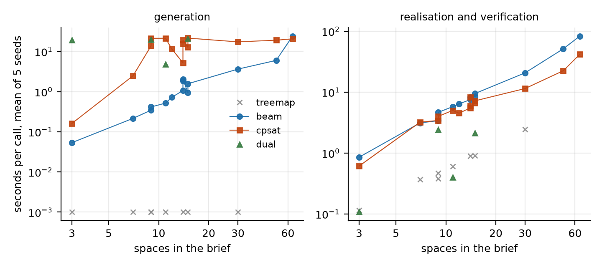
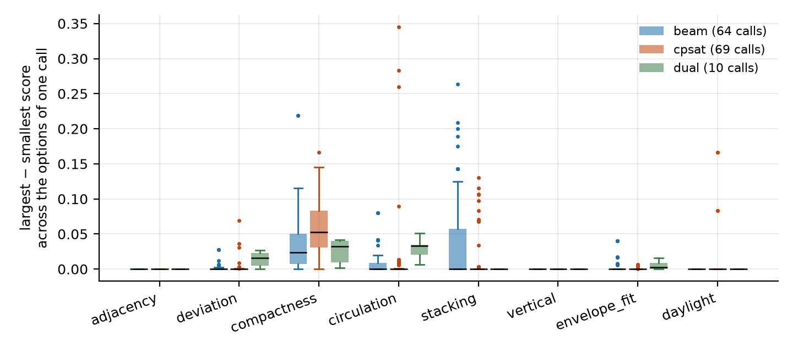
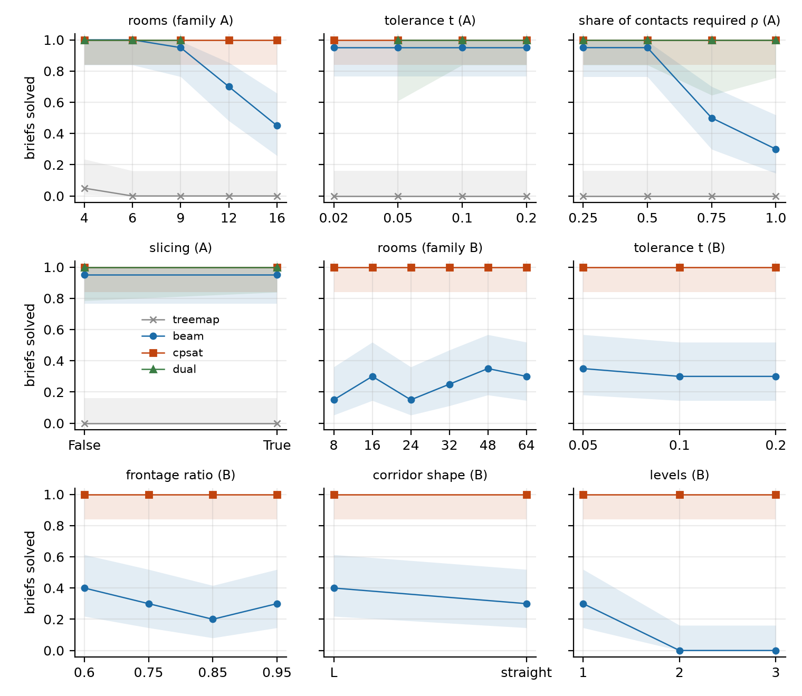

# SpaceTope paper experiments: results and analysis

Every table below is computed from the files in this folder by `bench/paper_results.py`, which fills
`RESULTS.in.md` and writes this file. Edit the template, not this file. Figures come from
`bench/paper_figures.py`.

- **Machine:** Apple M3 Pro, 11 cores, 18 GB, macOS 14.1, Python 3.11.9 (`machine.json`).
- **Pins:** topologicpy 0.9.71, topologic_core 8.0.0, ortools 9.15.
- **Code:** frozen at `f6bc234` (tag `paper-v1`). Later commits change the engine by licence header lines
  only; §11 lists what else changed and which runs it touches.
- **Budgets:** the bench defaults. CP-SAT and dual 20 s per call, 5 s per CP-SAT solve; beam width 16; K = 8.
- **Statistics:** mean ± standard deviation over seeds; Wilson 95 % intervals on proportions; paired Wilcoxon
  signed-rank tests on the same fixture and seed. No mean is pooled over fixtures of different sizes: tables
  are per fixture, and the paired tests count cells.

## Summary

1. **The verifier rejects every injected fault and accepts every control.** Geometry and hard-constraint
   faults: {{kind_geometry}}. Faults against the brief: {{kind_brief}}. The pilot's seven checks caught 4 of
   21 brief faults; the two new checks close that. Controls rejected: {{kind_control}}.
2. **The verdict, the topology class and the scores are invariant** under translation, mirroring, rotation,
   reordering and swapping identical spaces, on every placement tested.
3. **The pre-verifier agrees with the kernel** on all but two of about 6,000 placements. It never hides a
   placement the kernel accepts.
4. **CP-SAT and Z3 enumerate identical solution sets** on the two small briefs and both reject the
   contradictory one.
5. **CP-SAT is the reliable generator, the beam the fast one.** On planted briefs with a known solution,
   CP-SAT solves all 520. The beam solves fewer as rooms and required contacts grow, and about
   a quarter of the corridor-served family. The treemap baseline meets the brief on 1 of 240.
6. **The beam's warm start is what lets CP-SAT reach the two large briefs.** Without it CP-SAT verifies 1 and
   2 options on them instead of 29 and 29. The beam's re-dimensioning pass costs about a third of its time
   and lowers deviation slightly; it does not change what verifies.
7. **Three scores never tell options apart** (adjacency, vertical, and daylight almost never), and options
   carry many contacts nobody asked for: about 105 unasked room-to-room pairs on the 64-space school.
8. **Reproducibility is exact for the beam and for CP-SAT in deterministic mode**, absent for CP-SAT in
   default mode, and absent for `dual` in either mode.

Open items that affect what the paper may claim are in §11.

---

## 1. E1: fault injection (Table 6.1)

```
.venv/bin/python bench/validate.py --placements bench/paper/placements \
    --faults bench/paper/e1_faults_v2.csv --metamorphic bench/paper/e1b_metamorphic_v2.csv
```

Input: the {{n_placements}} verified placements of seeds 0 and 1 from E2, all generators and fixtures. One
fault of each kind is applied to each placement where the fault applies (a placement with no shaft gets no
shaft fault). Code: working tree after `2922bcc` with the corrected `bench/validate.py` (§11). Six workers.

{{table_faults}}

Rejected by kind, pilot (seven checks, 70 placements, 2026-10-16) against this run (nine checks):

| kind | pilot, seven checks | this run, nine checks |
|---|---|---|
| geometry and hard constraint | 13/13 | {{kind_geometry}} |
| brief | 4/21 | {{kind_brief}} |
| control (must pass) | not run | rejected {{kind_control}} |

**Reading.** Every fault is rejected, and each by the check that names it: an overlap fails the build, a gap at
a required contact fails `required_contacts`, a room out of its band fails `bands`, a slid room fails `doors`.
The two faults the pilot let through (a room grown out of band, a room 1 mm off a required contact) are the
two the new checks were written for.

**Adjacency is not a substitute for the check.** The adjacency score falls below 1 for a lost required
contact but not for a room out of band, out of the envelope, or with too short a door wall. A score ranks;
only a check rejects.

**The control needed a correction, and the first run is kept.** In the first run (`e1_faults.csv`) the
control was rejected {{kind_control_first}}. Each rejection was correct: moving a room 1 mm off an incidental
neighbour also pushed it out of the envelope (66 placements), left a door wall 1 mm short (18), or took it
off its only corridor (10; where access is by the door rule the corridor contact is not a required pair).
The control now opens a joint only where the move does nothing else. First run, for the record:

{{table_faults_first}}

**Some brief faults also fail the build**, in both runs (`gap_required` 21, `shrink_room` 11). Where the
moved or shrunk room was joined to the rest only through that wall, the cells no longer form one group
through shared faces, which is a failed merge by rule 1. Every other check then fails with it.

## 2. E1b: metamorphic relations

Same command and sample as E1.

{{table_metamorphic}}

Translation and rotation apply only where the brief has no envelope (or a square one), hence fewer placements.

**Reading.** The verdict, the topology class and every score except `envelope_fit` are unchanged under all
six relations. The verifier does not depend on where the plan sits, which way it faces, the order of the
space list, or which of two identical rooms is which.

**`swap_identical` needed a correction, and the first run is kept.** The first definition called two rooms
identical when programme, size, tolerance and level wish matched, and ignored what each must touch. In
`clinic`, `consult_1` and `consult_2` are the same size but only `consult_1` must touch `treatment`.
Swapping them breaks that contact and the verifier rejects it, correctly. All 87 first-run failures are
swaps of rooms with different required neighbours; all 268 swaps of rooms with the same neighbours pass.
The relation now also requires the same wishes, required contacts and marked doors. First run:

{{table_metamorphic_first}}

## 3. E1d: pre-verifier against the kernel

```
.venv/bin/python bench/e1d_from_csv.py bench/paper bench/paper/e1d_confusion.csv
```

The pre-verifier judges integer boxes without the kernel. The table compares its verdict with the kernel
verifier's on every E2 option and every E1 and E1b placement.

{{table_e1d}}

**Reading.** The pre-verifier never rejects what the kernel accepts, so it hides nothing from the architect.
The two disagreements on E2 options go the other way and cost one wasted build each:

- beam, `school_three_levels`, seed 4, option 4: the kernel build itself failed (every check fails,
  starting with `built`). This is the intermittent kernel fault, not a pre-verifier miss.
- cpsat, `small_hospital`, seed 2, option 1: the kernel fails `doors` alone. Not yet traced; it may be the
  same fault reaching an aperture (NOTES §12) or a real difference in the door rule. See §11.

## 4. E2: main comparison (Tables 6.2 and 6.3)

```
.venv/bin/python bench.py --fixtures all --seeds 0-4 --out bench/paper/scoreboard_e2.csv \
    --per-option bench/paper/options_e2.csv --save-placements bench/paper/placements
```

Commit `33f3856` (`paper-v1` plus the machine record). 196 rows, 5,611 s. Scores are means over the verified
options of a call, so a call with none verified shows 0.

**Table 6.2, core fixtures**, mean ± SD over five seeds:

{{table_core}}

**Table 6.3, all fixtures by generator.** Each cell is verified/options summed over five seeds · mean
topology classes per call · mean generation time.

{{table_all}}

**Beam against CP-SAT**, paired on the 70 (fixture, seed) cells both ran:

{{table_beam_cpsat}}

**Reading.**

- **The treemap never meets a brief.** It returns one tiling per call and it fails `bands` or
  `required_contacts` every time. Under the pilot's seven checks it passed; this is the M2 gate line that
  now fails and is left failing (`docs/PLAN.md` §5, 2026-11-03).
- **CP-SAT verifies what it returns** (498 of 499 options) but returns fewer than K on the larger briefs
  within its 20 s. The beam always returns eight and loses some to verification: 58 of 560, of which 34 on
  `school_l_corridor`, the chained-corridor brief it is known to manage on few seeds.
- **The beam is faster on every fixture but the largest**, by one to two orders of magnitude on small
  briefs, because CP-SAT spends its budget looking for more options.
- **`dual` runs on four of the eight single-level fixtures.** It declines the rest with a stated reason:
  the rooms cannot tile a rectangle within tolerance, or a wished contact encloses a room. Where it runs, it
  gives the most topology classes per option.

## 5. E3: scaling

Same run as E2. Mean ± SD over five seeds, fixtures in order of size.

{{table_scaling}}



**Reading.** Realisation and verification grow smoothly with the number of spaces and dominate the beam's
total from about ten spaces up: 83 s against 24 s of generation on the 64-space school. CP-SAT's generation
time is its budget, flat near 20 s from nine spaces up. CP-SAT's realisation time is lower on the large
briefs only because it returns fewer options to build. The treemap's generation time rounds to zero and is
drawn at 1 ms.

## 6. E10: do the scores tell options apart? (Table 6.4)

```
.venv/bin/python bench/e10_from_csv.py bench/paper/options_e2.csv bench/paper/e10_discrimination.csv
.venv/bin/python bench/e10c_pairs.py bench/paper/placements bench/paper/e10c_pairs.csv
```

Both read the E2 run; nothing is regenerated. A score vector is the eight scores rounded to four decimals.

**Table 6.4a, score spread.** Per score: calls in which it varies across the options / calls with more than
one verified option, then the largest spread seen in any call.

{{table_spread}}



**Table 6.4b, contacts per verified option:** touching pairs · required pairs · room-to-room pairs nobody
asked for.

{{table_contacts}}

**Table 6.4c, contacts nobody asked for, by programme pair,** summed over all verified options of the run
(required contacts of the same pair in brackets):

{{table_pairs}}

**Reading.**

- **Adjacency and vertical never vary, and daylight in 4 calls of 143.** A verified option meets every
  required contact, so adjacency is 1 by construction now that the check exists. These three scores carry no
  ranking information among verified options.
- **Compactness is the score that separates options**; deviation, circulation and stacking vary in about a
  quarter of calls. About half the beam's options and two thirds of CP-SAT's have a score vector of their
  own.
- **Unasked contacts grow with the brief and are almost all room-to-room.** They outnumber required
  room-to-room contacts by about ten to one for the beam and eight to one for CP-SAT. Nothing scores or
  checks them. This is the measured case for affinities (`apart`, `near`) as a brief-level wish.

## 7. E5: solver cross-check

```
.venv/bin/python bench/e5_z3.py > bench/paper/e5_z3.txt
```

```
{{e5}}
```

**Reading.** Z3 and CP-SAT find the same sets of wall assignments, exhaustively, on both briefs, and both
prove the contradictory brief impossible. The relational model neither loses nor invents arrangements.

## 8. E8: ablations (Table 6.5)

```
.venv/bin/python bench.py --fixtures all --generators beam cpsat --seeds 0-4 \
    --params-json '{"beam": {"redim": false}, "cpsat": {"warm_start": false}}' \
    --out bench/paper/e8_ablation.csv --per-option bench/paper/e8_options.csv
```

Commit `2922bcc`. 2,448 s. Compared with the E2 run, cell by cell.

**Beam without its final re-dimensioning** (`redim=False`):

{{table_ablation_beam}}

**CP-SAT without the beam warm start** (`warm_start=False`):

{{table_ablation_cpsat}}

**Paired tests** over (fixture, seed) cells:

{{table_ablation_tests}}

**Reading.**

- **Re-dimensioning barely changes what verifies** (two cells of 70, in opposite directions). It takes about a third of the beam's generation time
  and lowers deviation in 11 cells, all single-level. Multi-level briefs are unchanged by construction: the
  multi-level beam never re-dimensions (`docs/PLAN.md`, commit `f127838`).
- **The warm start decides the large briefs.** Without it CP-SAT's verified options over five seeds fall
  from 29 to 1 on `small_hospital` and from 29 to 2 on `school_three_levels`: in 20 s it rarely finds a first
  solution on its own.
- **On two mid-size briefs the warm start costs options.** `office_30` and `school_l_corridor` return more
  verified options without it (35 against 25, and 35 against 30). A plausible cause is time spent on the
  beam run and on the hint; it was not investigated.
- The pooled test on verified options (p near 0.05) mixes those two opposite effects and should not be quoted
  alone; the per-fixture table is the result.

## 9. E9: planted briefs

```
.venv/bin/python bench/planted_run.py --out bench/paper/e9_planted.csv --save bench/paper/planted
```

Engine as `paper-v1`. 12,569 s for the main run. Each brief is written back from a placement built first, so
it has at least one exact solution. One factor varies at a time around a base, 20 seeds per point.
{{e9_rows}} rows; {{e9_crashed}} crashed after the retry of 13 cells (§11).

- **Family A:** a rectangle cut into n rooms, no circulation. Base n = 9, t = 0.10, ρ = 0.5, slicing.
- **Family B:** rooms on a 1.8 m corridor. Base 16 rooms, t = 0.10, frontage 0.75, straight, double-loaded,
  one level.

Each cell: briefs solved / briefs that ran, with the Wilson interval; then `class`, the number of briefs
where the planted topology class is among the verified options; then how often `dual` declined.

**Family A**

{{table_planted_a}}

**Family B**

{{table_planted_b}}



**Generation time against size**, mean ± SD over the seeds that ran:

{{table_planted_time}}

**Reading.**

- **CP-SAT solves every planted brief**, 520 of 520, in both families, across every swept parameter, including
  64 rooms and three levels. That is the completeness result: where a solution is known to exist, the exact
  engine finds one within the bench budget.
- **The beam degrades with size and with constraint density in family A**: from 20 of 20 at n = 4 to 9 of 20
  at n = 16, and from 19 of 20 at ρ = 0.25 to 6 of 20 at ρ = 1.0. Tolerance and slicing make no difference.
- **The beam solves about three in ten of one-level family B and none of the multi-level points.** No swept
  parameter explains it, including the frontage ratio the sweep was designed to cross. This is weaker than the beam's
  record on the hand-written fixtures and is the result most worth a follow-up (§11).
- **`dual` solves every brief it accepts and declines many**: most of family A at n ≥ 12, at tight tolerance
  and at high ρ (the rooms cannot tile a rectangle within tolerance), and all of family B (its stated
  reason: the wished contacts leave a room enclosed).
- **The treemap solves 1 of 240.**
- **Beyond the budget:** the beam's generation time on family B grows to about 280 s at 64 rooms, and
  CP-SAT's to about 140 s, well past its nominal 20 s. CP-SAT's time includes its beam warm start, which is
  the likely cause; it was not investigated.

**The planted class is rarely recovered, and that is a property of the measure.** The topology class labels
each room by its size and compares the whole shared-wall graph. Planted rooms all differ in size, so
recovery means the very room in the very place, with the same incidental contacts. Where the brief pins the
plan down it happens (n = 4; ρ = 1.0 for CP-SAT), and elsewhere almost never. Family B has no required
room-to-room contacts, so the order of rooms along the corridor is free and the planted order is one of
thousands. A looser class that ignores room size was tried on 32 small briefs and recovered 2, so it was not
adopted. `solved` is E9's result. Recall of topology classes needs the exhaustive ground truth of the
optional E9b.

## 10. E14: reproducibility

```
.venv/bin/python bench.py --fixtures all --seeds 0-1 --deterministic ...   # twice: det_a, det_b
.venv/bin/python bench.py --fixtures all --seeds 0 ...                     # three times: def_a, def_b, def_c
.venv/bin/python bench/e14_repro.py bench/paper/e14 bench/paper/e14_repro.csv
```

Commit `2922bcc`. 6,597 s in all, one machine. A cell is one (generator, fixture, seed); it is identical when
every run returns the same placements in the same order. The overlap is the Jaccard index of two runs'
option sets, smallest pair, averaged over cells.

{{table_repro}}

**Reading.**

- **The beam and the treemap are deterministic** in either mode.
- **CP-SAT in deterministic mode repeats exactly**, in every cell that returned options. Three of its 28
  cells returned none in either run (`office_30` on both seeds, `small_hospital` on seed 0), where default
  mode returned some on every cell of E2: one worker on a deterministic budget is a smaller search than
  eight workers for 20 s. The two deterministic runs took 2,106 s and 2,081 s for two seeds.
- **CP-SAT in default mode never repeats**, and two runs share under a tenth of their options. Results from
  default mode are reproducible as distributions over seeds, not as plans.
- **`dual` does not repeat in either mode** on `eight_rooms_corridor` and `hotel_floor`. `--deterministic`
  reaches the `cpsat` generator only, not the sizing solves inside `dual`.
- Not done: the second machine.

---

## 11. Departures from the brief, gates that changed, and what looked wrong

**Departures**

1. **The freeze.** `paper-v1` is `f6bc234`. E2 ran at `33f3856`, E8 and E14 at `2922bcc`. Between them the
   engine (`spacetope/`, `bench.py`, `bench/planted_run.py`) gained licence header lines and nothing else.
   `bench/validate.py` did change, twice: crash handling on 2026-11-03, and on 2026-11-23 the
   `swap_identical` relation, the `gap_incidental` control and the worker pool. E1 and E1b are the only runs
   that depend on it, and both were rerun on the final version. The honest tag for the validator is
   `paper-v2`; it has not been made, and the validator's final version is not yet committed.
2. **E1 and E1b have two runs.** The first (`e1_faults.csv`, `e1b_metamorphic.csv`) is kept beside the
   corrected one (`*_v2.csv`). The paper should quote the second and describe the first.
3. **E9 planted class** is reported but is not the headline (§9).
4. **Crashed cells were retried.** 13 E9 cells and one E8 cell (`beam`, `school_three_levels`, seed 2) died
   with `TypeError: unhashable type: 'list'`, the intermittent kernel fault of NOTES §12 in which a cell's
   name is read back as a list. They were rerun in a fresh process and appended.
5. **E14 on one machine only.**
6. **Figures** need matplotlib, which is not a spacetope dependency and was not added to `.venv`. They were
   drawn from a separate environment.
7. **Optional experiments** E1c, E9b and E4 were not run.

**Gates that changed**

- **M2, `test_treemap_baseline_verified`, fails and stays failing** (`docs/PLAN.md` §5, 2026-11-03). The
  treemap gets 0 verified options under nine checks. All other gates were green at the freeze
  (`step1_gates_summary.txt`). They have not been rerun since; no engine code has changed.

**What looked wrong, and is still open**

1. **The beam on planted corridor briefs** (§9): about three in ten solved on one level and none on two or
   three, against 8 of 8 on the hand-written hospital and school. Either planted briefs are harder in a way
   the fixtures are not, or `planted.py` writes family B briefs the beam's corridor heuristics do not expect.
2. **`dual` under `--deterministic`** (§10): either the flag should reach it or the paper should say it does
   not.
3. **One `doors` disagreement** between the pre-verifier and the kernel (§3), untraced.
4. **The intermittent kernel fault** reached four places in these runs: a failed build in E2, cell names in
   E1, E8 and E9. Every case passed on retry. The harness works around it with short-lived workers; the
   package-side guard suggested in NOTES §12 is not written.
5. **`ProcessPoolExecutor(max_tasks_per_child=8)` hangs** on Python 3.11.9 once every worker has served its
   tasks: the run stops with work queued and no workers. `bench/validate.py` now starts a fresh pool per
   batch.
6. **CP-SAT exceeds its 20 s budget** on large multi-part briefs (§9), up to about 140 s at 64 rooms.
